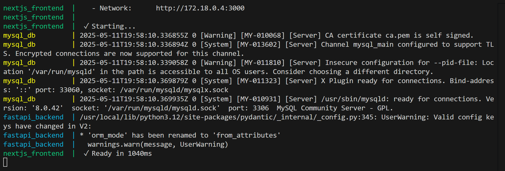
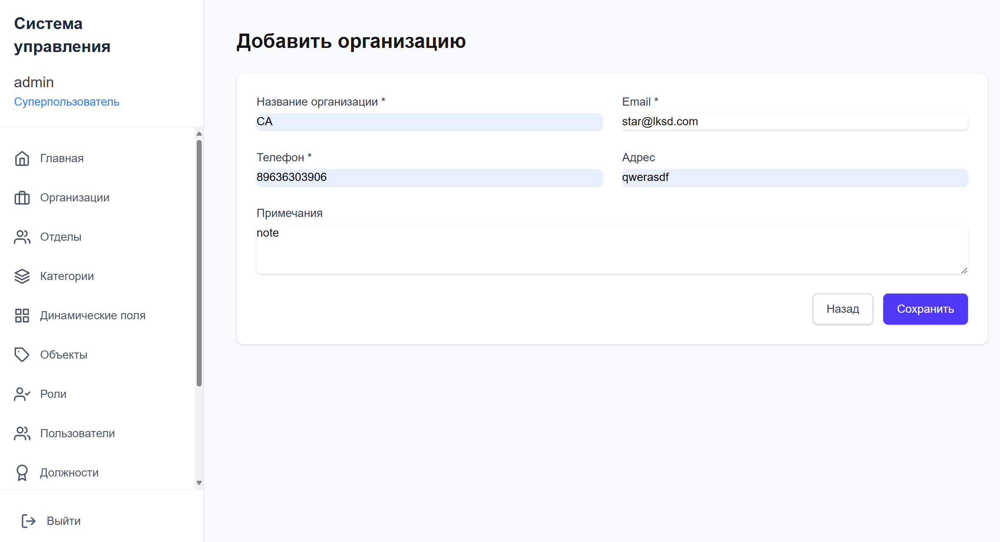
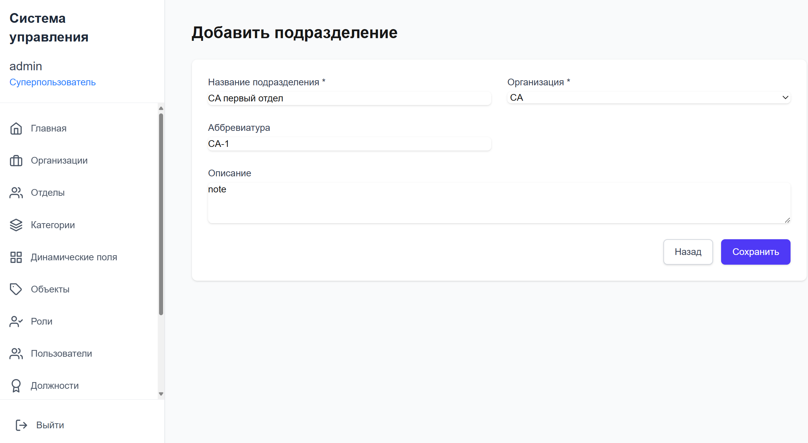
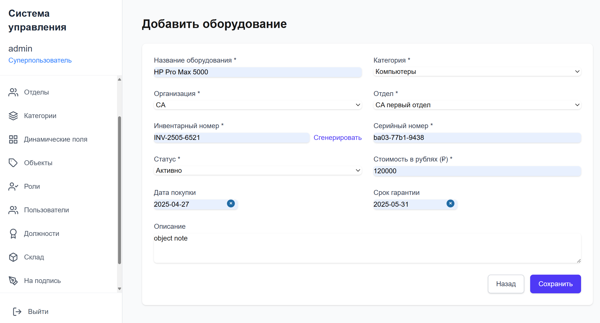
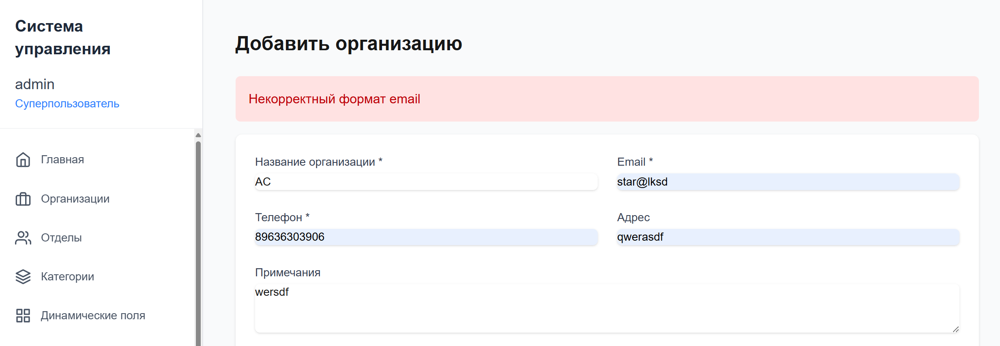

---

# 📦 Инструкция по работе с системой управления организациями

> Документация для запуска, настройки и базового использования системы

---

## ⚙️ Шаг 1: Запуск приложения


### 1. Запустите приложение:

```bash
cd it-storage
docker-compose up --build
```

>   
*Рисунок 1: Успешный запуск приложения*

---

## 🏗️ Шаг 2: Создание организации, подразделения

### 1. Перейдите на вкладку организации:

```
http://localhost:8000/organizations
```

>   
*Рисунок 2: Страница управления организациями*


### 2. Создайте организацию


>   
*Рисунок 3: Создание организации через интерфейс приложения*

---

### 3. Создайте подразделение организации

>   
*Рисунок 4: Создание подразделения организации*

---

### 4. Создайте оборудование

>   
*Рисунок 5: создание оборудования*

---

## Исключительные ситуации


### При неверном формате email появится соответствующая ошибка


>   
*Рисунок 6: Ошибка при создании организации*

---

## 📌 Заключение

Эта система позволяет:
- Управлять организациями, подразделениями и объектами
- Выполнять операции с оборудованием
- Экспортировать данные об оборудовании в EXCEL
---

